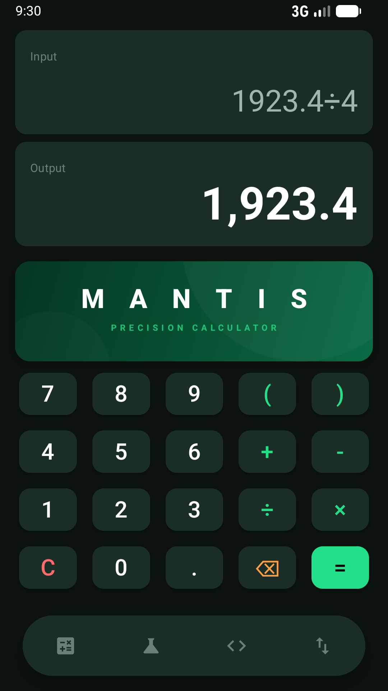
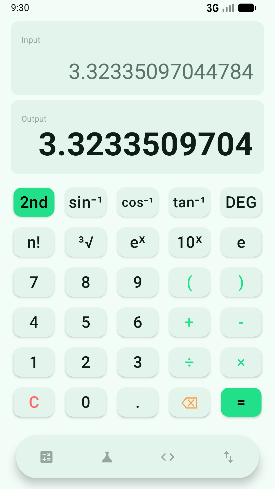
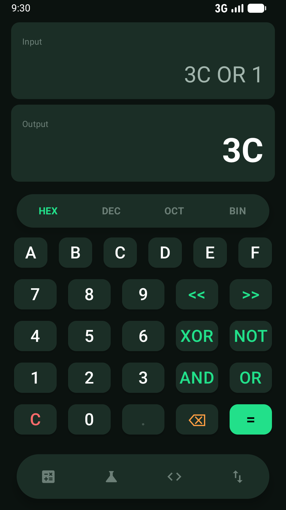
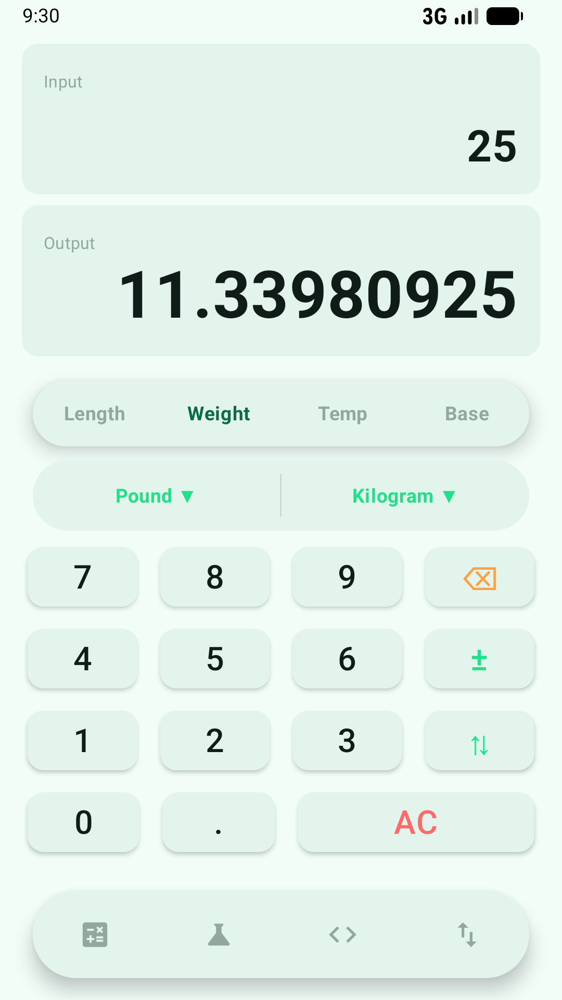
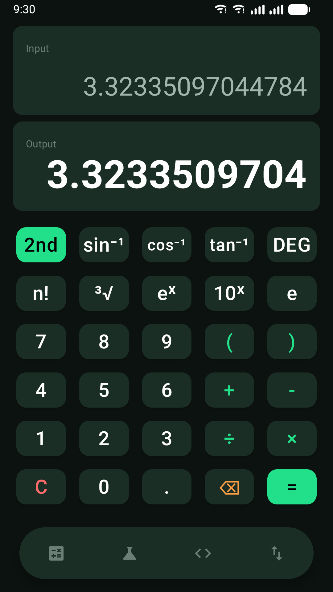
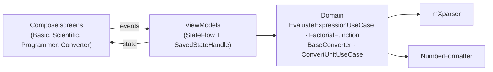

<div align="center">


# Mantis

**Four precision calculators in one private, offline Android app:** Basic, Scientific, Programmer and Unit Converter.

[](https://github.com/redrighthand2007/MANTIS/actions/workflows/android.yml)


[](LICENSE)

</div>

## 📸 Screenshots

| Basic | Scientific | Programmer | Converter | Dark mode |
|---|---|---|---|---|
|  |  |  |  |  |

## ✨ Features

- **Basic & Scientific:** Trigonometry and its inverses (via the **2nd** key), roots, logs, powers, π and e, with a Degree/Radian toggle.
- **True factorials:** Whole numbers are exact; decimals use the gamma function (2.5! = 3.3233…).
- **Programmer:** DEC, HEX, OCT and BIN with chained bitwise operations (AND, OR, XOR, NOT, `<<`, `>>`) on full 64-bit values.
- **Unit Converter:** Length, Weight, Temperature and number bases, updating live as you type, using exact international unit definitions.
- **Chained calculations:** Answers flow back into the input at full precision, so you can keep calculating.
- **Precision:** 15 significant digits, scientific notation for very small and very large results, and clear "Error" messages instead of silent wrong answers.
- **Adaptive design:** Light and dark themes, edge-to-edge, large font sizes, split-screen, tablets, right-to-left languages, and screen reader labels on every key.
- **100% offline & private:** No internet permission, no ads, no tracking. See the [privacy policy](docs/privacy-policy.md).

## 🧠 Engineering Highlights

- **Floating-point output you can trust.** Results are rounded to 15 significant digits with `BigDecimal`, so `0.1 + 0.2` shows `0.3`, tiny values like `3.33E-10` never collapse to `0`, and huge values never show fake trailing digits ([`NumberFormatter`](app/src/main/java/com/kush/mantis/core/util/NumberFormatter.kt)).
- **Correct maths where the library falls short.** mXparser's `!` silently floors decimals (`2.5! = 6`), so postfix factorials are rewritten into a custom function that is exact for integers and uses Gamma for decimals ([`FactorialFunction`](app/src/main/java/com/kush/mantis/features/basic/domain/FactorialFunction.kt)).
- **A UI that can't freeze.** Expressions are evaluated on a background dispatcher, with an input length cap measured against real parser timings; stale results are discarded if the user keeps typing ([`EvaluateExpressionUseCase`](app/src/main/java/com/kush/mantis/features/basic/domain/EvaluateExpressionUseCase.kt)).
- **A real state machine for Programmer mode.** Left-to-right chaining, 64-bit overflow rejection, shift clamping (Kotlin's `shl` wraps at 64) and two's-complement display across bases ([`ProgrammerViewModel`](app/src/main/java/com/kush/mantis/features/programmer/presentation/ProgrammerViewModel.kt)).
- **Survives process death.** Every mode restores the in-progress calculation through `SavedStateHandle` when Android reclaims memory.
- **Reusable keypad DSL.** Screens are declared row by row from shared composables (`KeypadRow`, `OperatorKey`, `EqualsKey`, …), keeping each screen short and consistent ([`Keypad.kt`](app/src/main/java/com/kush/mantis/core/ui/components/Keypad.kt)).
- **Tested and shrunk.** 68 unit tests cover the engine, formatting, every ViewModel and state restoration; CI runs tests, lint and a build on every push; release builds use R8 (≈1.5 MB APK).

## 🏗️ Architecture

MVVM with unidirectional data flow: screens send events, ViewModels update `StateFlow`s, and pure domain classes do the maths.



## 🛠️ Tech Stack

| Area | Choice |
|---|---|
| Language | Kotlin 2.2 |
| UI | Jetpack Compose, Material 3 |
| Architecture | MVVM, Clean Architecture, Unidirectional Data Flow |
| Async | Kotlin Coroutines and StateFlow |
| Dependency injection | Dagger Hilt |
| Navigation | Navigation Compose with type-safe routes |
| Math engine | [mXparser](https://mathparser.org/) |
| Testing | JUnit 4, kotlinx-coroutines-test |
| CI | GitHub Actions |
| Platform | Android 8.0+ (API 26), targets Android 16 (API 36) |

## 📁 Project Structure

```text
MANTIS/
├── app/src/main/java/com/kush/mantis/
│   ├── core/
│   │   ├── di/           # Hilt module (coroutine dispatcher)
│   │   ├── ui/components # Keypad DSL, display panel, auto-sizing text, selectors
│   │   └── util/         # Number formatting, cursor editing
│   ├── features/
│   │   ├── basic/        # Expression evaluation, factorial, Basic screen
│   │   ├── scientific/   # Function mapping, 2nd/DEG modes
│   │   ├── programmer/   # Base conversion, bitwise state machine
│   │   └── converter/    # Unit definitions and conversion
│   ├── navigation/       # Routes, animated NavHost, floating tab bar
│   └── ui/theme/         # Colours, typography, Material theme
├── app/src/test/         # Unit tests
├── docs/                 # Privacy policy, store listing, screenshots
└── .github/workflows/    # CI
```

## ⚙️ Getting Started

```bash
git clone https://github.com/redrighthand2007/MANTIS.git
cd MANTIS
```

Open the folder in a recent version of Android Studio, let Gradle sync, then run the `app` configuration on an emulator or a device with Android 8.0 or newer.

## 🧪 Tests

```bash
./gradlew testDebugUnitTest
```

## 📦 Release Build

1. Create an upload key in Android Studio (*Build → Generate Signed App Bundle → Create new*).
2. Copy `keystore.properties.example` to `keystore.properties` and fill in your key details (the file is git-ignored).
3. Build the bundle:
   ```bash
   ./gradlew bundleRelease
   ```
   The signed bundle is written to `app/build/outputs/bundle/release/app-release.aab`.

## 🗺️ Roadmap

- [x] Basic, Scientific, Programmer and Converter modes
- [x] Precision formatting and gamma-based factorials
- [x] Split-screen, tablet, large text and right-to-left support
- [x] State restoration and background evaluation
- [ ] Calculation history
- [ ] More converter categories (Volume, Area, Speed)
- [ ] Dedicated landscape layout

## 🤝 Contributing

Issues and pull requests are welcome on the [issues page](https://github.com/redrighthand2007/MANTIS/issues).

## 📄 License

The Mantis source code is released under the [MIT License](LICENSE).

Mantis uses [mXparser](https://mathparser.org/), which has its own dual license: free for non-commercial use, with a paid license required for commercial use.

## 👨‍💻 Author

**Kush** · GitHub [@redrighthand2007](https://github.com/redrighthand2007)
