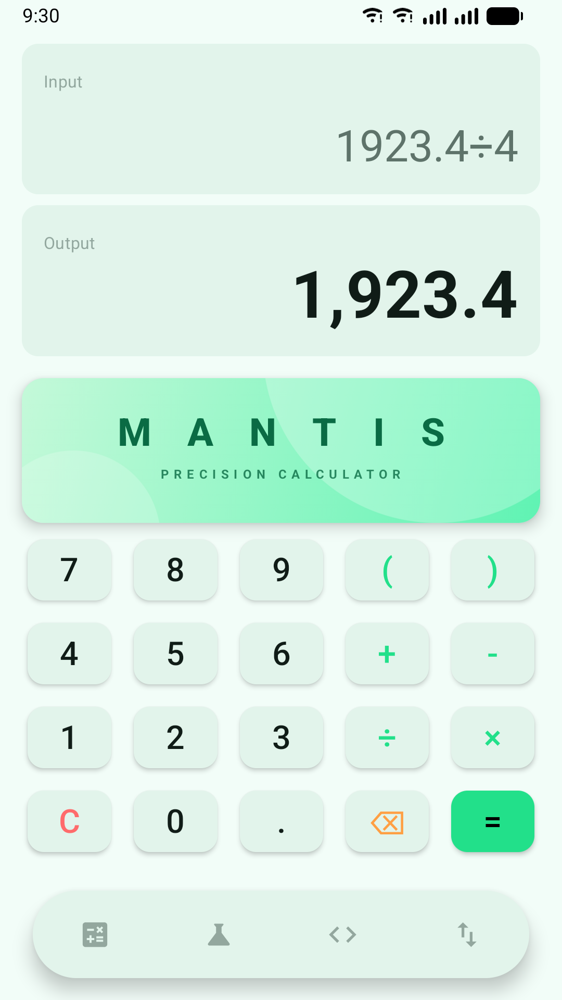
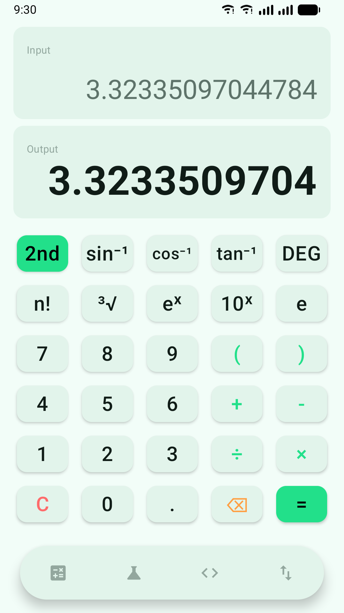
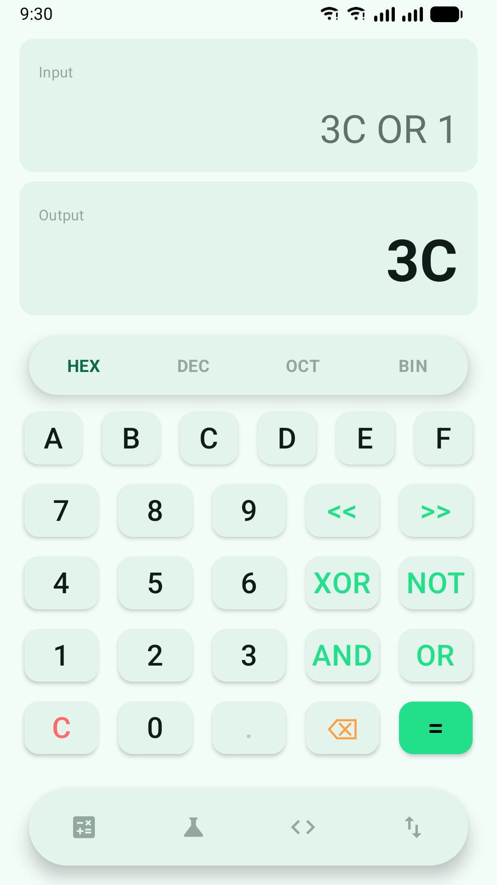
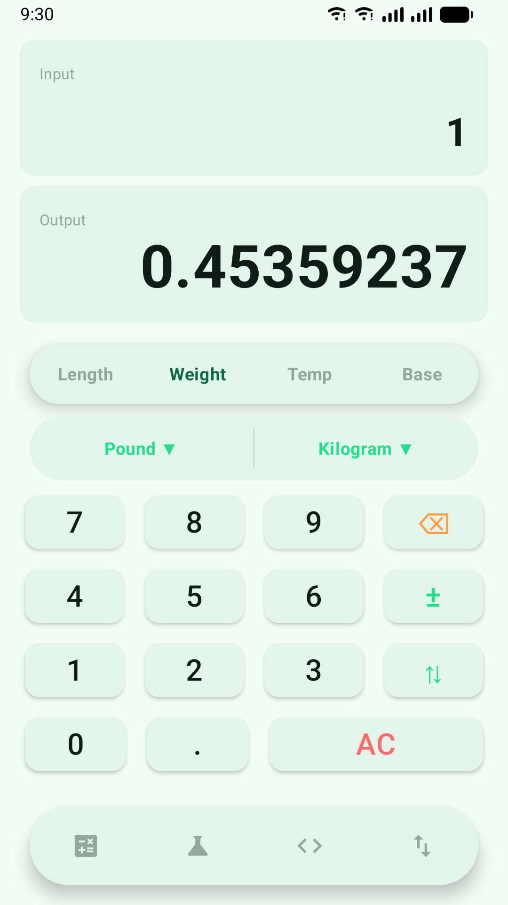
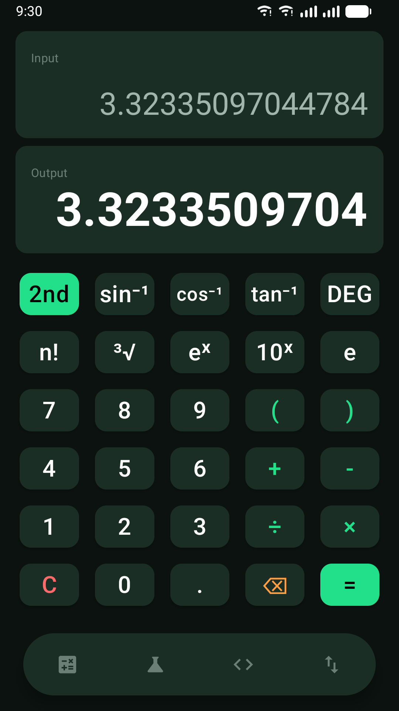

# Mantis (Precision n' Power)
The ultimate offline calculator. Basic. Scientific. Programmer. Converter.

## 📸 Screenshots
| Basic | Scientific | Programmer | Converter | Dark mode |
|---|---|---|---|---|
|  |  |  |  |  |

## ✨ Features
- **Basic & Scientific:** Trigonometry and inverse trig (via the **2nd** key), roots, logs, powers, π and e, with a Degree/Radian toggle, powered by mXparser.
- **True factorials:** Whole numbers are exact; decimals use the gamma function (2.5! = 3.3233…).
- **Programmer Mode:** DEC, HEX, OCT and BIN with chained bitwise ops (AND, OR, XOR, NOT, `<<`, `>>`) on full 64-bit values.
- **Unit Converter:** Length, Weight, Temperature and number bases, updating live as you type, with exact international unit definitions.
- **Chain Calculations:** Answers flow back into the input at full precision, so you can keep calculating.
- **Precision:** 15 significant digits, scientific notation for tiny and huge results, and clear "Error" messages instead of silent wrong answers.
- **Adaptive Design:** Light and dark themes, edge-to-edge, large font sizes, split-screen, tablets, and screen reader labels on every key.
- **100% Offline & Private:** Zero tracking. Zero ads. Zero databases. No internet permission. See the [privacy policy](docs/privacy-policy.md).

## 🎯 Why This Project?
Most calculator apps today are either too basic, fragmented across multiple apps, or bloated with intrusive ads and unnecessary permissions.

Mantis solves this by providing:
- Four professional-grade math engines unified into one app.
- A clean grid layout that adapts to any screen size.
- A completely private, offline calculation environment.

## 🛠️ Tech Stack
- **Frontend:** Android (100% Kotlin, Jetpack Compose, Material 3)
- **Math Engine:** mXparser (Robust mathematical evaluation)
- **Architecture:** MVVM, Clean Architecture, Unidirectional Data Flow (UDF)
- **Dependency Injection:** Dagger Hilt
- **Navigation:** Jetpack Navigation Compose
- **Targets:** Android 8.0+ (API 26), built for Android 16 (API 36)

## 📁 Project Structure
```text
MANTIS/
├── app/src/main/java/com/kush/mantis/
│   ├── core/           # Shared UI components, Formatters, DI modules
│   ├── features/       # Feature modules
│   │   ├── basic/      # Basic Math UI, ViewModel, EvaluateUseCase, factorial
│   │   ├── scientific/ # Trigonometric engine and state
│   │   ├── programmer/ # Base-N conversions & bitwise logic
│   │   └── converter/  # Unit conversion engine
│   ├── navigation/     # Animated route transitions & Bottom bar
│   └── ui/             # Material 3 colors, typography, themes
├── docs/               # Privacy policy, Play Store listing and store assets
└── README.md
```

## ⚙️ Installation
1. **Clone the repository:**
   ```bash
   git clone https://github.com/redrighthand2007/MANTIS.git
   cd MANTIS
   ```
2. **Open the project:** Open the folder in a recent version of Android Studio.
3. **Sync Gradle:** Allow Android Studio to sync the Gradle files and download all required dependencies.

## 🚀 Usage
- Build and run the app on an Android Emulator or physical device (Android 8.0 / API 26+).
- Use the floating bottom bar to switch between calculation modes.
- Press **=** to evaluate; your answer stays in the input so you can keep building on it.

## 🧪 Tests
```bash
./gradlew testDebugUnitTest
```
Unit tests cover the expression engine, number formatting, every mode's ViewModel, and state restoration.

## 📦 Release Build
1. Create an upload key in Android Studio (*Build → Generate Signed App Bundle → Create new*) and keep the `.jks` file backed up.
2. Copy `keystore.properties.example` to `keystore.properties` and fill in your key details. This file is git-ignored.
3. Build the Play Store bundle:
   ```bash
   ./gradlew bundleRelease
   ```
   The signed bundle is written to `app/build/outputs/bundle/release/app-release.aab`. Release builds are shrunk with R8.

Store listing text and graphics are in [`docs/play-store-listing.md`](docs/play-store-listing.md) and [`docs/store-assets/`](docs/store-assets/).

## 🧠 How It Works
- **Architecture:** The app follows the MVVM (Model-View-ViewModel) architecture and uses Jetpack Compose for declarative UI. State is managed via Kotlin StateFlow and Coroutines, and survives the app being closed in the background.
- **Calculation Flow:** When the user hits `=`, the expression is evaluated by mXparser on a background thread, and the full-precision answer is pushed back into the input so calculations can be chained.

## 🗺️ Roadmap
- [x] Basic & Scientific Calculator Engines
- [x] Programmer & Converter Modes
- [x] Modern UI: Adaptive Banners, Floating Taskbar
- [x] Smooth sliding navigation transitions
- [x] "Evaluate on Equals" continuous math engine
- [x] Split-screen, large text and right-to-left language support
- [ ] Custom Landscape Mode optimization
- [ ] Additional Unit Converter modules (Volume, Area, Speed)

## 🤝 Contributing
Contributions, issues, and feature requests are welcome! Feel free to check the [issues page](https://github.com/redrighthand2007/MANTIS/issues) if you want to contribute.

## 📄 License
The Mantis source code is distributed under the MIT License. See [LICENSE](LICENSE) for more information.

Mantis uses [mXparser](https://mathparser.org/), which has its own dual license: free for non-commercial use, with a paid license required for commercial use.

## 👨‍💻 Author
**Kush**
GitHub: [@redrighthand2007](https://github.com/redrighthand2007)

## 🙌 Acknowledgements
- [Jetpack Compose](https://developer.android.com/jetpack/compose) for modern Android UI
- [mXparser](https://mathparser.org/) for the incredibly robust math evaluation engine
